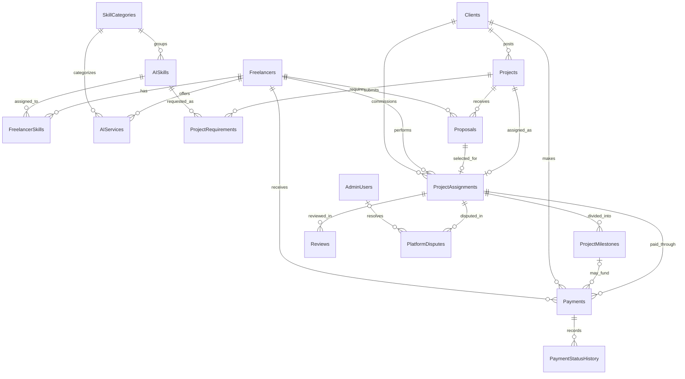

# NeuroLance Hub database design

## Purpose and scope

This document describes the relational database implemented for the AI projects and services freelancing platform. It preserves the table names and relationships supplied in the original module scripts. It also records assumptions needed to turn the scenario into a workable schema.

## Entity relationship model

`||` means exactly one; `o|` means zero or one; `o{` means zero or many. `ProjectAssignments.ProjectID` and `ProposalID` are both unique, so a project and a proposal can each appear in at most one assignment. The schema allows a project to receive multiple proposals before one is assigned.

Review participants are represented by `ReviewerType`, `ReviewerID`, and `RevieweeID`; the IDs are polymorphic (they refer to either `Clients` or `Freelancers`). The trigger validates those IDs against the assignment because a normal SQL Server foreign key cannot point to one of two tables based on a type value. `PlatformDisputes.RaisedByID` follows the same polymorphic pattern. The existing schema is retained as requested.

## Assumptions

1. A freelancer and a client are separate account records; one person who uses both roles has one record in each table.
2. Each freelancer email, client email, and admin email is unique within its own table. The schema does not enforce cross-table email uniqueness.
3. AI skills belong to one skill category. A freelancer can have many skills, and a project can require many skills; the bridge tables hold those many-to-many relationships.
4. A project may receive multiple proposals but has at most one assignment, matching the existing unique constraint. Reassignment after termination would require a future schema change because the unique project constraint preserves the original one-assignment design.
5. An assignment is created from a proposal. The assignment trigger checks the selected proposal, project owner, and freelancer agree, then sets proposal/project statuses.
6. A payment is considered included in account totals only while its `PaymentStatus` is `Released`. The client total uses gross amount; freelancer earnings use net amount. A full refund of a released record reverses the corresponding total; payment rows are not physically deleted.
7. For sample records only, the platform fee is demonstrated at 10%; this is not a fixed product policy. Each payment stores its fee-rate snapshot and the fee function accepts a rate argument.
8. Rating summaries default to 5.00 where no reviews exist, consistent with the original table defaults. Review triggers recalculate summaries after review changes.
9. Sample records are fictional, use `.test` email domains, and are not valid login or payment credentials.
10. Database objects enforce the business rules implemented here. The future application must still authenticate users, authorize actions, validate input, protect secrets, and integrate a real payment provider.

## Relational mapping

- `Freelancers(FreelancerID PK)`; `Clients(ClientID PK)`; `AdminUsers(AdminID PK)` are independent account entities.
- `SkillCategories(CategoryID PK)` owns `AISkills(SkillID PK, CategoryID FK)`; `Freelancers` and `AISkills` are mapped through `FreelancerSkills(FreelancerSkillID PK, FreelancerID FK, SkillID FK, UNIQUE(FreelancerID, SkillID))`.
- Freelancer service offerings map to `AIServices(ServiceID PK, FreelancerID FK, CategoryID FK)`.
- A client owns projects: `Projects(ProjectID PK, ClientID FK)`. Required skills map through `ProjectRequirements(RequirementID PK, ProjectID FK, SkillID FK, UNIQUE(ProjectID, SkillID))`.
- Project applications map to `Proposals(ProposalID PK, ProjectID FK, FreelancerID FK, UNIQUE(ProjectID, FreelancerID))`.
- A selected proposal is represented by `ProjectAssignments(AssignmentID PK, ProjectID FK UNIQUE, ProposalID FK UNIQUE, FreelancerID FK, ClientID FK)`. The assignment trigger validates that the related IDs agree.
- Assignment-dependent details use `ProjectMilestones(MilestoneID PK, AssignmentID FK)`, `Payments(PaymentID PK, AssignmentID FK, optional MilestoneID FK)`, `Reviews(ReviewID PK, AssignmentID FK, UNIQUE(AssignmentID, ReviewerType))`, and `PlatformDisputes(DisputeID PK, AssignmentID FK, optional ResolvedByAdminID FK)`. The payment status audit is a one-to-many child: `PaymentStatusHistory(PaymentStatusEventID PK, PaymentID FK)`.

## Normalization rationale

### First normal form

Columns store single values rather than lists. Freelancer skills and project requirements are stored as rows in bridge tables, not comma-separated values. Separate rows are used for proposals, assignments, milestones, payments, reviews, and disputes.

### Second normal form

Every table has a primary key. In the bridge tables, skill attributes such as `ProficiencyLevel` and `RequiredLevel` depend on the complete freelancer/skill or project/skill pair. Account and project attributes depend on their respective single-column keys.

### Third normal form

Category descriptions are stored in `SkillCategories`, not repeated for each skill or service. Project details are stored in `Projects`, and proposals refer to projects and freelancers by key. Payment, review, and dispute facts are kept in their own tables rather than repeated on account records.

The original design also contains summary columns (`Freelancers.TotalEarnings`, `Freelancers.AverageRating`, `Freelancers.CompletedProjects`, `Clients.TotalSpent`, and `Clients.ClientRating`). These are intentional cached aggregates for convenient reads, so they are derived rather than strictly normalized facts. Triggers maintain them for payment releases/refunds, review changes, and assignment completion changes. Applications should not update those summary columns directly.

## Database programmable objects

| Object type | Object | Responsibility |
| --- | --- | --- |
| Trigger | `TR_ProjectAssignments_SyncProjectAndProposalStatus` | Validates participant consistency; synchronizes project/proposal status and completed project count. |
| Trigger | `TR_Payments_UpdateAccountTotals` | Validates payment participants/milestone and applies released payment changes to client spending and freelancer earnings. |
| Trigger | `TR_Payments_EnforceStatusAndWriteHistory` | Enforces payment transitions, immutable financial fields, idempotent ledger preservation, and status-event history. |
| Trigger | `TR_PaymentStatusHistory_Immutable` | Prevents status-audit rows from being updated or deleted. |
| Trigger | `TR_Reviews_UpdateParticipantRatings` | Requires completed assignments, validates review participants, and recomputes account rating summaries. |
| Trigger | `TR_ProjectAssignments_ProtectReviewedCompletion` | Prevents reopening an assignment after reviews have been published. |
| Trigger | `TR_PlatformDisputes_ValidateRaiser` | Validates that a client or freelancer on the assignment raised the dispute. |
| Function | `ufn_CalculatePlatformFee` | Calculates a fee for a supplied gross amount and rate. |
| Function | `ufn_CalculateFreelancerRating` | Returns a freelancer's mean client review score, or `NULL` if none exists. |
| Function | `ufn_CalculateClientRating` | Returns a client's mean freelancer review score, or `NULL` if none exists. |
| View | `vw_FreelancerProjectSummary` | Assignment, project, client, freelancer, released-payment, and rating summary. |
| View | `vw_ClientProjectSummary` | Client project list with proposal counts, assignment, and released-payment totals. |
| View | `vw_ProjectPaymentSummary` | Payment totals grouped by project/assignment/payment status. |
| View | `vw_PaymentHistory` | Per-payment project, milestone, participant, fee, status, and reference details. |
| View | `vw_PaymentStatusHistory` | Per-payment status transitions with actor, reason, and UTC timestamp. |
| View | `vw_ReviewDetails` | Review text, rating, project, participants, and completed-assignment indicator. |
| View | `vw_ParticipantReviewSummary` | Freelancer and client review averages and counts. |
| View | `vw_PaymentWorkspaceAssignments` / `vw_PaymentWorkspaceMilestones` | Participant IDs, remaining amounts, and review eligibility for the backend. |
| Procedure | `usp_PaymentLoginAccount` | Backend-only lookup of role/email and password hash. |
| Procedure | `usp_CreateProject` | Creates a project and skill requirements atomically using `ProjectRequirementInput`. |
| Procedure | `usp_FindFreelancersBySkill` | Finds available freelancers with a selected skill and optional filters. |
| Procedure | `usp_GeneratePaymentRevenueReport` | Summarizes payment amounts by day and status for an optional date range. |
| Procedure | `usp_RecordPayment` | Calculates the commission snapshot, checks assignment/milestone caps, and creates an idempotent `Pending` request. |
| Procedure | `usp_TransitionPayment` | Applies an authorized status transition and records its reason and actor. |
| Procedure | `usp_CreateAssignmentReview` | Creates one direction-specific review for a completed assignment after participant validation. |
| Procedure | `usp_GetClientPaymentHistory` / `usp_GetFreelancerPaymentHistory` | Retrieves payment history for the selected client or freelancer ID. |

## Important implementation boundaries

- `CompletedProjects` is synchronized by assignment status changes. There is no independent rule that forces a project to be marked completed only after every milestone is approved; the coursework team should confirm the desired workflow.
- The SQL scripts do not hash or verify passwords. The Member 4 backend uses memory-hard scrypt with random salts and timing-safe comparison. Original sample password markers cannot authenticate; dedicated preview accounts are provisioned separately.
- Payment amounts, statuses, ratings, and review text are queryable business facts, not passwords; hashing them is not a payment-security control. The sample payment records are synthetic. `Held in Escrow` is a demonstration status and does not mean real money is held.
- The Member 4 Express API authenticates users, authorizes payment/review actions, and calls SQL through a dedicated role with parameterized commands. Database credentials stay server-side. No gateway is implemented; the ledger does not move funds. See [Payment preview setup](./PaymentPreview.md).
- `CREATE TABLE` scripts are intended for a clean database. The object script uses `CREATE OR ALTER` and the sample script checks for its own records before inserting them.
