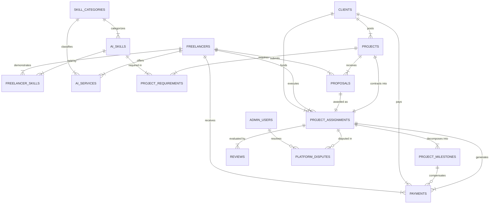

# NeuroLance Hub - Conceptual Design, ERD, Relational Mapping & Normalization
**Module:** PUSL2019 – Information Management & Retrieval  
**Assessment:** Coursework (C1: 50%)  
**System Name:** NeuroLance Hub (AI Projects & Services Freelancing Platform)  
**Target Database Engine:** Microsoft SQL Server (Transact-SQL)

---

## 1. Introduction to the Case Study
The rapid acceleration and adoption of foundational models, generative intelligence, and deep learning architectures have generated unprecedented demand for highly specialized technical expertise. Traditional generalist freelance marketplaces (such as Upwork or Fiverr) are poorly optimized for the unique lifecycle of Artificial Intelligence projects. AI deliverables involve data confidentiality constraints, non-deterministic performance thresholds (e.g., F1-score, Dice score, BLEU score, latency limits), specialized GPU compute infrastructure, and iterative training cycles that fail under rigid, conventional freelance management.

**NeuroLance Hub** is engineered to resolve this market friction. It establishes a centralized, high-integrity relational data store designed specifically for:
- Connecting institutional clients and startups with vetted AI researchers and practitioners.
- Cataloging fine-grained AI competencies (Large Language Models, Edge AI, Computer Vision, MLOps, Reinforcement Learning, and AI Safety).
- Facilitating standardized pre-packaged AI services as well as custom enterprise bids.
- Implementing an escrow-secured milestone payment infrastructure with transparent tiered platform commission accounting.
- Maintaining bidirectional reputation systems and formal dispute adjudication mechanisms.

---

## 2. Core Design Assumptions
1. **User Separation**: While clients and freelancers participate in the same marketplace, their data profiles, operational models, and metrics diverge significantly (clients track total spend, company verticals, and payment methods; freelancers track hourly rates, portfolios, skill proficiencies, and cumulative earnings). They are maintained in dedicated entities with specialized constraints.
2. **Skill Taxonomy**: AI skills belong to standardized categories (e.g., *Computer Vision*, *Generative AI & LLMs*, *MLOps*) to enable structured aggregation, indexing, and talent matching.
3. **Many-to-Many Skill Associations**:
   - A freelancer possesses multiple AI skills at varying proficiency levels (`Beginner`, `Intermediate`, `Expert`).
   - A project requires multiple distinct AI skills at defined minimum competence thresholds.
4. **Assignment Exclusivity**: A client selects exactly one winning proposal per project assignment contract ($1:1$ relationship between an active project and its project assignment). Once assigned, all competing proposals for that project are automatically marked as `Rejected`.
5. **Milestone-Driven Execution**: Enterprise AI projects are broken down into measurable, phased milestones (e.g., *Phase 1: Exploratory Data Analysis & Annotation*, *Phase 2: Baseline Model Training*, *Phase 3: Quantization & Dockerized Inference Deployment*).
6. **Financial Integrity & Tiered Platform Fees**: Platform fees are calculated automatically upon deposit/release using a tiered scale ($10\%$ for transactions under \$2,000, $8\%$ for \$2,000–\$10,000, and $5\%$ for high-value enterprise contracts over \$10,000). The mathematical invariant `GrossAmount = NetAmount + PlatformFee` is strictly enforced via database check constraints.
7. **Bidirectional Review Constraint**: To guarantee integrity, exactly one review from client-to-freelancer and one review from freelancer-to-client can exist per completed project assignment contract.

---

## 3. Enhanced Entity-Relationship (EER) Diagram

---

## 4. Step-by-Step Relational Mapping
The conceptual EER model is mapped into a relational schema following standard transformation rules:

### Step 1: Mapping Regular Strong Entities
- **Clients** $\rightarrow$ `Clients(ClientID [PK], FullName, Email, PasswordHash, CompanyName, Industry, Country, BillingAddress, ContactNumber, TotalSpent, ClientRating, IsActive, CreatedAt)`
- **Freelancers** $\rightarrow$ `Freelancers(FreelancerID [PK], FullName, Email, PasswordHash, ProfessionalTitle, Bio, HourlyRate, YearsOfExperience, Country, TotalEarnings, AverageRating, CompletedProjectsCount, AvailabilityStatus, IsActive, CreatedAt)`
- **AdminUsers** $\rightarrow$ `AdminUsers(AdminID [PK], FullName, Email, PasswordHash, Role, ContactNumber, IsActive, CreatedAt)`
- **SkillCategories** $\rightarrow$ `SkillCategories(CategoryID [PK], CategoryName, Description, CreatedAt)`

### Step 2: Mapping 1:N Binary Relationships
- **AISkills**: Participates in $1:N$ relationship with `SkillCategories`. The primary key `CategoryID` is migrated as a Foreign Key.
  - `AISkills(SkillID [PK], CategoryID [FK], SkillName, Description, CreatedAt)`
- **AIServices**: Offered by `Freelancers` ($1:N$) and categorized by `SkillCategories` ($1:N$).
  - `AIServices(ServiceID [PK], FreelancerID [FK], CategoryID [FK], ServiceTitle, Description, DeliveryDays, StartingPrice, RevisionsIncluded, IsActive, CreatedAt)`
- **Projects**: Posted by `Clients` ($1:N$).
  - `Projects(ProjectID [PK], ClientID [FK], Title, Description, Scope, Budget, DurationWeeks, ProjectStatus, DeadlineDate, CreatedAt)`

### Step 3: Mapping Many-to-Many ($M:N$) Relationships
$M:N$ relationships are resolved into associative junction relations containing foreign keys from both participating entities:
- **Freelancers $\leftrightarrow$ AISkills** $\rightarrow$ `FreelancerSkills(FreelancerSkillID [PK], FreelancerID [FK], SkillID [FK], ProficiencyLevel, YearsExperience, AcquiredAt)` with `UNIQUE(FreelancerID, SkillID)`.
- **Projects $\leftrightarrow$ AISkills** $\rightarrow$ `ProjectRequirements(ProjectRequirementID [PK], ProjectID [FK], SkillID [FK], RequiredLevel)` with `UNIQUE(ProjectID, SkillID)`.
- **Projects $\leftrightarrow$ Freelancers (Proposals)** $\rightarrow$ `Proposals(ProposalID [PK], ProjectID [FK], FreelancerID [FK], CoverLetter, BidAmount, EstimatedDays, ProposalStatus, SubmittedAt)` with `UNIQUE(ProjectID, FreelancerID)`.

### Step 4: Mapping 1:1 and Composite Dependent Entities
- **ProjectAssignments**: Acts as a binding contract between a project and the accepted proposal. Both `ProjectID` and `ProposalID` are defined as foreign keys with `UNIQUE` constraints to enforce $1:1$ cardinality.
  - `ProjectAssignments(AssignmentID [PK], ProjectID [FK, UQ], ProposalID [FK, UQ], FreelancerID [FK], ClientID [FK], AgreedPrice, StartDate, ExpectedCompletionDate, ActualCompletionDate, AssignmentStatus)`
- **ProjectMilestones**: $1:N$ decomposition of `ProjectAssignments`.
  - `ProjectMilestones(MilestoneID [PK], AssignmentID [FK], MilestoneTitle, Description, Amount, DueDate, MilestoneStatus, CreatedAt)`
- **Payments**: Multi-party financial ledger relation.
  - `Payments(PaymentID [PK], AssignmentID [FK], MilestoneID [FK, Nullable], ClientID [FK], FreelancerID [FK], GrossAmount, PlatformFee, NetAmount, PaymentMethod, PaymentStatus, TransactionReference [UQ], PaymentDate, ReleasedDate)`
- **Reviews**: Bidirectional feedback relation with `UNIQUE(AssignmentID, ReviewerType)` to prevent duplicate evaluations.
  - `Reviews(ReviewID [PK], AssignmentID [FK], ReviewerType, ReviewerID, RevieweeID, Rating, Comment, CreatedAt)`
- **PlatformDisputes**: Dispute resolution table linking to `ProjectAssignments` and `AdminUsers`.
  - `PlatformDisputes(DisputeID [PK], AssignmentID [FK], RaisedByID, RaisedByType, Reason, Description, DisputeStatus, ResolutionNotes, ResolvedByAdminID [FK, Nullable], CreatedAt, ResolvedAt)`

---

## 5. Normalization up to Third Normal Form (3NF)

### 5.1 First Normal Form (1NF)
A relation is in 1NF if and only if all domain values are atomic (no repeating groups, multi-valued attributes, or comma-separated lists), and each table possesses a unique primary key.
- **Decomposition of Multi-Valued Attributes**: Instead of storing skills as comma-separated text strings within the `Freelancers` table (e.g. `"PyTorch, LangChain, YOLO"`), a distinct `AISkills` catalog and `FreelancerSkills` associative entity were created.
- **Discrete Milestones**: Project milestones are not embedded within `Projects` or `ProjectAssignments`; they are decomposed into `ProjectMilestones`.
- **Atomic Data**: Names, addresses, and transaction amounts are segregated into atomic columns (`GrossAmount`, `PlatformFee`, `NetAmount`).

### 5.2 Second Normal Form (2NF)
A relation is in 2NF if it is in 1NF and every non-key attribute is fully functionally dependent on the primary key (no partial functional dependencies).
- In composite relationship tables (such as `FreelancerSkills` and `ProjectRequirements`), attributes such as `ProficiencyLevel` or `RequiredLevel` depend on both `(FreelancerID, SkillID)` and `(ProjectID, SkillID)` respectively.
- By introducing dedicated surrogate primary keys (`FreelancerSkillID`, `ProjectRequirementID`) and composite uniqueness constraints, every non-prime attribute is fully functionally dependent on the entire primary key.
- Entity-specific attributes (e.g., `CategoryName` or `SkillName`) are kept in their own tables (`SkillCategories`, `AISkills`) rather than repeated across associative tables, preventing update and deletion anomalies.

### 5.3 Third Normal Form (3NF)
A relation is in 3NF if it is in 2NF and no non-prime attribute is transitively dependent on the primary key ($X \rightarrow Y$ where $Y \rightarrow Z$).
- **Elimination of Transitive Category Dependencies**:
  - In an unnormalized design, one might include `CategoryID` and `CategoryName` inside `AISkills`. However, `SkillID -> CategoryID` and `CategoryID -> CategoryName` creates a transitive dependency (`SkillID -> CategoryName`).
  - **Resolution**: `SkillCategories` was isolated into its own relation, ensuring `AISkills` references only `CategoryID`.
- **Decoupling Project Clients & Freelancer Assignments**:
  - `Payments` and `Reviews` reference `AssignmentID`. While `ClientID` and `FreelancerID` are captured for query indexing and fast ledger lookups, they are locked to the assignment contract.
- **Calculated & Derived Attributes**:
  - Fields such as `PlatformFee` and `NetAmount` are validated by database-level invariant check constraints (`GrossAmount = NetAmount + PlatformFee`) and generated via deterministic User Defined Functions (`fn_CalculatePlatformFee`), preventing manual calculation drift.

---

## 6. Database Programmability Architecture (Section 3)

| Object Name | Object Type | Business Purpose & Invariant Enforced |
| :--- | :--- | :--- |
| `fn_CalculatePlatformFee` | Scalar UDF | Implements tiered platform commission ($10\%$ for $<\$2,000$, $8\%$ for $\$2,000–\$10,000$, $5\%$ for $>\$10,000$). |
| `fn_GetFreelancerAverageRating` | Scalar UDF | Aggregates and calculates exact client review scores for any freelancer. |
| `fn_GetFreelancerTopSkills` | Scalar UDF | Generates an aggregated, comma-delimited string of verified AI competencies. |
| `fn_GetProjectPaymentSummary` | Table-Valued UDF | Computes gross paid, net released, escrow held, and outstanding project balances. |
| `TR_ProjectAssignments_AfterInsert` | Trigger | Atomically sets `Projects.ProjectStatus = 'Assigned'`, marks the winning `Proposals.ProposalStatus = 'Accepted'`, and auto-rejects competing bids. |
| `TR_Payments_AfterUpdate` | Trigger | On payment release, increments freelancer `TotalEarnings`, client `TotalSpent`, and marks milestone `Approved`. |
| `TR_Reviews_AfterInsertUpdate` | Trigger | Dynamically recalculates and updates `Freelancers.AverageRating` and `Clients.ClientRating`. |
| `vw_FreelancerProjectSummary` | View | Performance analytics: proposals submitted vs accepted, active assignments, earnings. |
| `vw_ClientProjectSummary` | View | Client dashboard: projects posted, ongoing, completed, budget allocated vs spent. |
| `vw_ProjectPaymentSummary` | View | Escrow audit view: project price, released payouts, escrow balances, outstanding dues. |
| `vw_AISkillMarketDemand` | View | Market demand analytics: skill supply vs project requirement demand and average budgets. |
| `sp_PostNewProject` | Stored Procedure | Atomic creation of a project and required technical competencies in a transaction. |
| `sp_AssignFreelancerToProject` | Stored Procedure | Validates proposal, creates assignment, auto-generates first deliverable milestone. |
| `sp_ProcessProjectPayment` | Stored Procedure | Manages escrow funding and fund release with platform commission calculations. |
| `sp_SearchFreelancersByAISkill` | Stored Procedure | Searches and filters verified freelancers by skill, proficiency level, rate, and rating. |
| `sp_GeneratePlatformRevenueReport`| Stored Procedure | Executive revenue report summarizing volume, platform fee revenue, and active accounts. |

---

## 7. Critical Evaluation & Future Expansion (Section 4)

### 7.1 Strengths of the Implemented Database Design
1. **Strict Data Integrity & ACID Compliance**: Every business invariant is enforced at the database layer using foreign keys with cascading actions, check constraints, unique constraints, and ACID-compliant transactional stored procedures.
2. **Normalized 3NF Architecture**: Minimizes redundant data storage, eliminates insertion/update/deletion anomalies, and simplifies future data extensions.
3. **Escrow Financial Safety**: Dedicated payment tables, explicit payment status tracking (`Pending`, `Held in Escrow`, `Released`, `Refunded`), and mathematical consistency constraints prevent fraudulent accounting or phantom balances.
4. **Optimized Indexing**: Non-clustered indexes on foreign keys, status columns, and search criteria guarantee rapid query performance as data scales.

### 7.2 Weaknesses and Practical Mitigations
1. **Dynamic Schema Complexity in AI**: AI models evolve rapidly; hardcoding skill attributes may require periodic categorization adjustments. *Mitigation*: The `SkillCategories` and `AISkills` catalog architecture allows administrators to introduce new models and frameworks dynamically without altering schema definitions.
2. **Transaction Log Growth with Large Datasets**: Detailed audit logs and multi-step triggers can increase transaction log usage under heavy workloads. *Mitigation*: Indexes and triggers are kept focused on indexed integer keys with `NOCOUNT ON` enabled.

### 7.3 Roadmap for Future Expansion
1. **Mobile Application Integration**: Expose RESTful / GraphQL API endpoints from the database views and stored procedures to power native iOS and Android mobile apps for real-time bid alerts and project notifications.
2. **Online Payment & Automated Escrow Gateway Integration**: Direct webhook integration with Stripe Connect or Web3 smart contract escrow to automatically trigger `sp_ProcessProjectPayment` upon cryptographic milestone verification.
3. **Real-Time Communication & Collaboration**: Integration of WebSocket messaging tables and live telemetry to support client-freelancer code walkthroughs, Jupyter notebook sharing, and milestone demonstrations.
4. **AI-Powered Matchmaking & Bid Scoring**: Deploy an internal semantic vector search engine (e.g. SQL Server 2025 Vector search or pgvector) to match project requirement descriptions with freelancer embedding profiles automatically.
5. **External AI Platform Integration**: Integrations with Hugging Face Hub, GitHub, and Kaggle APIs to automatically import and verify freelancer model weights, benchmarks, and public repository contributions.
