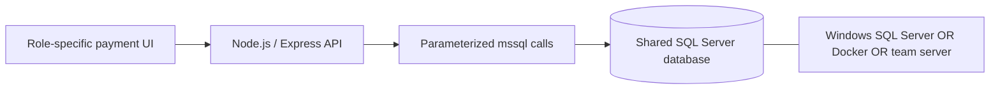

# Member 4 live payment preview

## What runs

| Layer | Technology | Teammate needs |
| --- | --- | --- |
| Interface | HTML, CSS, vanilla JavaScript | A browser; no frontend build tools |
| Backend | Node.js 24, Express 5 | Node.js 24 and `npm ci` |
| SQL connection | `mssql` with the Tedious driver | A reachable SQL Server TCP endpoint; no native ODBC driver |
| Database | Microsoft SQL Server / T-SQL | Local Windows SQL Server, a local container, or shared SQL Server |
| Local Linux database | SQL Server 2022 Docker container | Docker only if choosing this database option |
| Password verification | Node `crypto.scrypt` | Built into Node.js |
| Browser verification | Playwright / Chromium | Needed only to rerun browser tests |

Docker is **not required for every team member**. The app connects to a SQL Server host and port regardless of how that server runs. SQL Server Management Studio is a database client; a SQL Server database engine must also be installed or accessible.



## Local setup: Windows or Linux

1. Install Node.js 24 and make a local checkout of this branch. Run commands below from the repository root.
2. Make SQL Server available on `127.0.0.1:1433`. On Windows, enable TCP/IP and configure the actual port in SQL Server Configuration Manager. This preview uses SQL authentication; enable it if the instance only accepts Windows authentication. A local administrator performs setup once. The running app uses its own limited login.
3. Install the locked dependencies:

   ```sh
   npm ci
   ```

4. Create **local, ignored** `Backend/.env.setup` in an editor:

   ```dotenv
   PREVIEW_SETUP=true
   SQL_SERVER=127.0.0.1
   SQL_PORT=1433
   SQL_DATABASE=NeuroLanceHubDB
   SQL_USER=your_local_sql_admin_login
   SQL_PASSWORD="your_local_sql_admin_password"
   SQL_ENCRYPT=true
   SQL_TRUST_CERTIFICATE=true
   ```

   `SQL_TRUST_CERTIFICATE=true` is for a local self-signed development certificate. Use a trusted certificate and `false` on a shared environment. Do not commit or share environment files or credentials.

5. Provision the local preview:

   ```sh
   npm run db:prepare
   ```

   On an empty local database, this applies scripts 01–09 in order. On an existing foundation it applies 08–09 only. It does not reset the database. It creates dedicated synthetic preview accounts and assignments, seeds pending/held/released ledger records, creates the limited `neurohire_payment_app` SQL login, and writes ignored `Backend/.env` and `Backend/preview-accounts.txt`. Existing preview passwords are retained on reruns. Protect these local files; remove the setup credential file after provisioning if it is no longer needed.

6. Start the application:

   ```sh
   npm start
   ```

7. Open **http://127.0.0.1:3000/Application/payments/**. Use the role, email, and generated password from `Backend/preview-accounts.txt`. The server binds to localhost. Keep its terminal running while previewing.

Opening the HTML file directly or using the old static server on port 8000 does **not** run the payment API.

### Optional Docker database

If SQL Server is already installed or hosted by the team, skip Docker. Otherwise, after installing Docker, create a local development database container with a strong password:

```sh
docker run --name neurohire-sql -e ACCEPT_EULA=Y -e MSSQL_PID=Developer -e MSSQL_SA_PASSWORD="replace-with-strong-local-password" -p 127.0.0.1:1433:1433 -v neurohire_sql_data:/var/opt/mssql -d mcr.microsoft.com/mssql/server:2022-latest
```

Use that password for the local setup login `sa` in step 4. The app itself does not run as `sa`. If port 1433 is already used, choose another host port and update `SQL_PORT`. The named volume retains database files when the container stops. The tested Linux environment used an existing container named `sqlserver`; teammates do not need that same name.

### Existing shared SQL Server

The automatic preview seeder deliberately accepts localhost only. For a team server:

1. Have the database administrator apply the numbered SQL scripts in the [README order](../README.md#set-up-and-run-on-linux), including 08 and 09. Preserve the existing shared data; do not recreate its tables.
2. Create a dedicated SQL login/user and add the database user to `NeuroHirePaymentReviewAppRole`. Do not grant `db_owner`, `db_datareader`, or `db_datawriter` to the app login. Permissions inherited from other roles would widen this module's intended access.
3. Copy `Backend/.env.example` to `Backend/.env`. Set the actual host, port, database login, password, and trusted-certificate settings. Run `npm start`.
4. Integrate the team's account provisioning with the documented scrypt password format or adapt the login verifier to the team's agreed hash format. The original `DEMO_ONLY_NO_LOGIN_HASH` sample markers are intentionally rejected. Do not enable automatic login by selecting an arbitrary account ID.

## Try the workflows

| Role | Path | Actions |
| --- | --- | --- |
| Client | `/Application/payments/client/` | Record a payment for an owned assignment/milestone, see fees and net, cancel Pending, dispute Held, read history, review completed work |
| Freelancer | `/Application/payments/freelancer/` | See own payment history/net earnings, dispute Held, review the assigned client after completion |
| Administrator | `/Application/payments/admin/` | View platform ledger and reviews, apply permitted status transitions with a reason |

1. Sign in as Client, choose **Knowledge assistant · Payment preview**, enter an amount, and record it. It is persisted as Pending.
2. Open **View** to inspect the status timeline. Client actions are limited to cancel/dispute as appropriate.
3. Sign out and sign in as Admin. Open that payment, select **Held in Escrow**, enter a reason, and save. Then select **Released** and save with another reason. Commission and account totals update in SQL.
4. Sign in as Freelancer to see the net earnings and recorded history. A full refund reverses the released totals.
5. Under **Reviews**, choose **Search quality audit · Payment preview**, select a rating, and publish a review. This completed synthetic assignment is reserved for hands-on use. The other participant can submit the opposite review direction. Repeated reviews in the same direction are rejected.

Refresh pulls current values from SQL Server. Each role sees only its permitted records. Administrators can view all ledger records but cannot impersonate a client/freelancer reviewer. Latest lists are limited to 250 rows; summary amounts are calculated across all matching records.

## Security and accounting choices

- Passwords: scrypt, N=131072 (2^17), r=8, p=1, random 16-byte salt, 64-byte derived key, timing-safe comparison. Only encoded hashes are stored in the existing `Password` columns. A dummy hash reduces differences for missing accounts; sign-in is rate-limited.
- Sessions: random tokens in HttpOnly, SameSite=Strict cookies; a one-hour expiry; hashed token lookup in server memory. Mutation requests also require the exact configured Origin and a session CSRF token. Sessions are invalidated on sign-out and on server restart. `NODE_ENV=production` adds Secure cookies; actual public deployment requires HTTPS and a durable shared session store.
- SQL: parameterized commands/procedures, narrow database role, server-derived actor identities, and per-request ownership checks. Database credentials and password hashes are never sent to the browser. The service SQL role is a backend privilege boundary, not an end-user identity system.
- Commission: the server's `PLATFORM_FEE_BPS` controls the rate. 1000 means a 10% sample rate. SQL calculates the fee and saves the rate snapshot, gross, fee, and net. Browser-supplied rates and actor roles are ignored. Payment amounts use SQL decimals; JavaScript amount previews use integer cents.
- Audit: status events are append-only for ordinary application operations. SQL administrators remain privileged; this is not a cryptographically tamper-proof financial ledger. SHA-256 is used only to index high-entropy session tokens, never to hash passwords or hide monetary facts.
- Reviews are rendered as text, never injected as HTML. Script 09 widens `Reviews.Comment` to `NVARCHAR(MAX)` for multilingual text while preserving its name and relationships.
- Limits: this is a single-process coursework preview, with in-memory rate limits/sessions, no registration/password-reset service, no real escrow, no card collection, no external payment provider, no partial refunds, and no currency conversion. USD is a display convention; the original schema has no currency field. The ledger has full-refund semantics and no automatic link to the separate platform-dispute resolution module.

References: [Node.js scrypt](https://nodejs.org/download/release/v24.21.0/docs/api/crypto.html#cryptoscryptpassword-salt-keylen-options-callback), [OWASP password storage](https://cheatsheetseries.owasp.org/cheatsheets/Password_Storage_Cheat_Sheet.html), [node-mssql](https://github.com/tediousjs/node-mssql), [Microsoft SQL Server Linux containers](https://learn.microsoft.com/en-us/sql/linux/quickstart-install-connect-docker?view=sql-server-ver17).

## Verification and screenshots

Verified locally on 24 November 2026 with Node.js 24.21.0, SQL Server 2022 on Linux, and Chromium. The tests use dedicated synthetic preview accounts. They do not operate on real money.

| Check | Result |
| --- | --- |
| SQL clean install, repeatable Member 4 migration, rollback smoke test | Passed |
| API: 37 HTTP assertions plus SQL/accounting assertions | Passed: login/logout, role/ownership checks, CSRF/Origin, amount caps, idempotency, commission/net, transition audit, refund totals, completed-assignment reviews, duplicate rejection |
| App SQL login cannot read account password tables or directly update Payments | Passed |
| Browser: client recording, fee preview, review publication, admin hold/release/refund, freelancer workspace | Passed |
| Mobile layout at 390px; no uncaught browser exceptions | Passed; a clipping issue found during testing was corrected |

With the server running, rerun:

```sh
npm run test:api
npm run test:ui
```

Browser checks use `/usr/bin/chromium` when available on Linux, `PLAYWRIGHT_CHROMIUM_EXECUTABLE` if supplied, or Playwright's installed Chromium. If necessary run `npx playwright install chromium`. These tools are only required for testing, not normal use. Tests retain synthetic audit events and reviews; generated test payments are refunded on successful completion. Interrupted browser-test payments were cancelled with an audit reason after the layout correction. Repeated tests can reach the login rate limit; wait for its 15-minute window or restart your local preview.

The following PNGs are actual screenshots of the running application, not mockups:

- [Sign-in](./Screenshots/member4/01-sign-in.png)
- [Client payment workspace](./Screenshots/member4/02-client-payments.png)
- [Client reviews](./Screenshots/member4/03-client-reviews.png)
- [Mobile payment workspace](./Screenshots/member4/04-mobile-payments.png)
- [Administrator status history](./Screenshots/member4/05-admin-status-history.png)
- [Freelancer payment workspace](./Screenshots/member4/06-freelancer-payments.png)

These checks are evidence for the local coursework preview. They do not certify a production payment processor or replace the team's final integrated demonstration.
